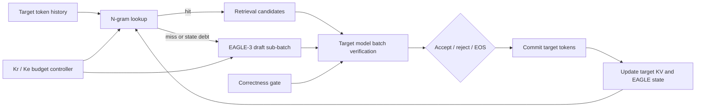

# BD-HSD

**Budget-Decoupled Hybrid Speculative Decoding** — 面向 LLM inference runtime 的预算解耦混合投机解码引擎。

BD-HSD 将便宜但覆盖不稳定的 N-gram 检索候选，与覆盖更稳定但每轮有固定执行成本的 EAGLE-3 神经草稿结合起来。目标模型始终负责候选验证和最终 token 提交；运行时只改变候选生成路径与资源分配，不改变验证语义。

这个仓库是一个可展示、可复核的系统项目，聚焦以下工程问题：

- N-gram 命中优先、EAGLE-3 miss fallback 的混合候选路由；
- 检索预算 `K_r` 与神经预算 `K_e` 的解耦及同引擎配对消融；
- EAGLE hidden state debt、KV Cache 追平和请求生命周期管理；
- mixed batch 下的选择性 EAGLE 子批、ragged attention metadata 压缩和结果 scatter；
- 目标模型验证、拒绝尾部处理、逐 token 正确性门控和运行时遥测。

## Architecture



一轮执行的关键不变量是：命中 N-gram 时可以减少未来神经候选展开，但已经提交的 target hidden state 必须按顺序消费；被拒绝的 future token 不进入持久状态；当 EAGLE state debt 达到边界时，调度器强制 catch-up。候选仍由 target logits 统一验证，因此 N-gram 与 EAGLE 只是 proposer，不能绕过 target verifier。

## Repository layout

```text
BD-HSD/
├── engine/vllm/                 # 可读的 vLLM BD-HSD overlay 源码快照
│   └── vllm/...
├── patches/
│   ├── vllm-bd-hsd.patch        # 对指定 vLLM 基线的可应用补丁
│   └── BASE_COMMIT.txt          # 基线 revision
├── scripts/
│   ├── benchmark_spec_decode.py # 单方法、batch 和 trace harness
│   ├── benchmark_budget_ablation.py
│   ├── analyze_budget_ablation.py
│   ├── analyze_stage_cost.py
│   └── budget_autotuner.py
├── tests/v1/spec_decode/        # proposer、路由和稀疏 batch CPU 测试
├── configs/                     # Qwen3-8B/EAGLE-3 配置与消融矩阵
├── docs/                        # 架构、正确性和实验协议
└── results/                     # 只保存结果格式说明，运行产物默认忽略
```

核心实现入口：

- `engine/vllm/vllm/v1/spec_decode/hybrid_proposer.py`：N-gram/EAGLE 候选合并、路由统计、debt 记账和 selective sub-batch metadata 压缩；
- `engine/vllm/vllm/v1/spec_decode/ngram_proposer.py`：批量 N-gram lookup、miss backoff 和 lookup trace；
- `engine/vllm/vllm/v1/spec_decode/eagle.py`：EAGLE-3 fallback budget 与 proposer 执行；
- `engine/vllm/vllm/v1/worker/gpu_model_runner.py`：候选生成、target 验证、KV/state 生命周期和运行时控制；
- `engine/vllm/vllm/v1/engine/core.py`：可选的逐轮 trace，用于把调度、执行和提交阶段拆开计时；
- `engine/vllm/vllm/config/speculative.py`：`hybrid_ngram_eagle3`、`K_r`、`K_e` 和 debt 参数。

BD-HSD 不修改 vLLM 的 FCFS/priority 请求排序策略；请求级的 N-gram hit/miss 路由和 EAGLE selective sub-batch 在 `GPUModelRunner` 内完成，避免把另一套 batch regrouping 策略混入核心项目。

## Quick start

仓库不携带 vLLM 全量源码、模型权重或数据集。先准备一个与 [`patches/BASE_COMMIT.txt`](patches/BASE_COMMIT.txt) 一致的 vLLM checkout，再应用 overlay：

```bash
git clone <your-vllm-checkout> vllm-bd-hsd
cd vllm-bd-hsd
git checkout 7ba609234a62ef0aa43d805149fa1a0af5990c20
git apply --check /path/to/BD-HSD/patches/vllm-bd-hsd.patch
git apply /path/to/BD-HSD/patches/vllm-bd-hsd.patch
pip install -e .
```

建议使用 Python 3.10/3.11、PyTorch CUDA、Numba 和 vLLM 所需的编译依赖。模型权重通过本地路径或 Hugging Face cache 提供；仓库中的 `configs/qwen3-8b-eagle3.json` 只描述实验契约，不下载权重。

先运行 proposer 和 sparse-batch 单元测试：

```bash
cd /path/to/BD-HSD
VLLM_ROOT=/path/to/vllm-bd-hsd
PYTHONPATH="$VLLM_ROOT" python tests/v1/spec_decode/test_hybrid_proposer.py
PYTHONPATH="$VLLM_ROOT" python tests/v1/spec_decode/test_ngram_sparse_batch.py
```

## GPU smoke and ablation

一个最小的 Qwen3-8B/EAGLE-3 离线 smoke：

```bash
cd /path/to/BD-HSD
VLLM_ROOT=/path/to/vllm-bd-hsd
PYTHONPATH="$VLLM_ROOT" python scripts/benchmark_spec_decode.py \
  --model /path/to/Qwen3-8B \
  --draft-model /path/to/Qwen3-8B-EAGLE3 \
  --method hybrid_ngram_eagle3 \
  --num-spec-tokens 10 \
  --hybrid-eagle-num-spec-tokens 3 \
  --prompt-lookup-min 3 \
  --prompt-lookup-max 7 \
  --hybrid-max-draft-skip-steps 1 \
  --hybrid-selective-draft-subbatch \
  --batch-sizes 1 4 8 \
  --num-prompts 2 \
  --max-tokens 64 \
  --max-model-len 4096 \
  --enforce-eager \
  --output results/runs/smoke.jsonl
```

正式预算实验使用同一个已加载的 engine，在平衡顺序下交替执行四组策略：

| Policy | `K_r` | `K_e` | State mode |
| --- | ---: | ---: | --- |
| `shared_k3_e3_shadow0` | 3 | 3 | shadow sync |
| `shared_k10_e10_shadow0` | 10 | 10 | shadow sync |
| `decoupled_k10_e3_shadow0` | 10 | 3 | shadow sync |
| `bsdh_k10_e3_debt1` | 10 | 3 | bounded one-step debt |

完整运行需要一个固定 EAGLE reference 文件和独立数据集 cohort：

```bash
PYTHONPATH="$VLLM_ROOT" python scripts/benchmark_budget_ablation.py \
  --model /path/to/Qwen3-8B \
  --draft-model /path/to/Qwen3-8B-EAGLE3 \
  --canitedit-path /path/to/canitedit.parquet \
  --reference-eagle /path/to/reference.jsonl \
  --prompt-indices 16 17 18 19 20 21 22 23 \
  --pairs 6 \
  --max-tokens 128 \
  --output results/runs/budget_ablation.json

python scripts/analyze_budget_ablation.py \
  --input results/runs/budget_ablation.json \
  --output results/runs/budget_summary.json
```

结果分析同时报告 request latency、accepted/drafted tokens、N-gram hit、EAGLE fallback、实际 EAGLE execution/skip、显存峰值和严格 reference gate。阶段 trace 可以交给 `analyze_stage_cost.py`，将 route、verify、rejection、EAGLE first pass、draft decode 和 metadata/控制开销拆开。

## Correctness contract

正确性验证分为三层：

1. **Proposer contract**：N-gram 命中优先，miss 才使用 EAGLE；原始 request 顺序和 ragged token index 在压缩/恢复后保持一致。
2. **State contract**：只把 target 已提交的 token/hidden state 写入 EAGLE 状态；拒绝尾部被丢弃；request 完成、取消、重排或 KV 重新映射时清理对应状态。
3. **Output contract**：固定 prompt、采样参数、长度和 reference 后，逐 token 比较输出；只有通过 reference gate 的请求才进入严格 latency 对比。

因此，接受率、吞吐和 latency 不能单独代表正确性。基准记录会保存 prompt hash、token hash、finish reason 和 mismatch IDs，方便把数值路径差异与真正的候选协议错误分开。

详细说明见：

- [架构与执行路径](docs/architecture.md)
- [KV Cache 与正确性不变量](docs/correctness.md)
- [实验协议与指标定义](docs/experiments.md)

## Scope

当前 overlay 面向文本、eager、greedy speculative decoding。selective EAGLE sub-batch 对 cross-attention、DCP 和 multimodal 输入有明确限制；state replay 是 opt-in 的研究扩展，默认路径不依赖它。模型权重、数据集、虚拟环境、原始机器日志和生成的图表不进入仓库。

## Resume-ready description

**BD-HSD — Budget-Decoupled Hybrid Speculative Decoding**

- Designed and implemented a vLLM speculative decoding runtime that combines N-gram retrieval with EAGLE-3 fallback and target-model batched verification.
- Decoupled retrieval and neural speculation budgets, adding same-engine paired ablations for acceptance length, token latency, throughput and GPU execution cost.
- Implemented request-level EAGLE state-debt accounting, bounded catch-up, KV Cache lifecycle management and selective draft sub-batching for heterogeneous batches.
- Built token-level correctness gates and routing/phase telemetry, and evaluated Qwen3-8B on RTX 4090/A100-class GPUs with PyTorch, CUDA and vLLM.
