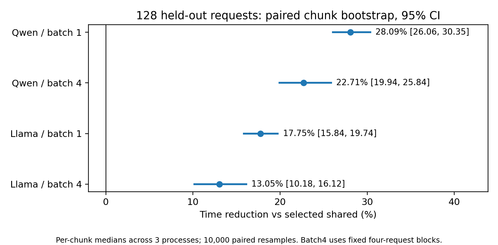
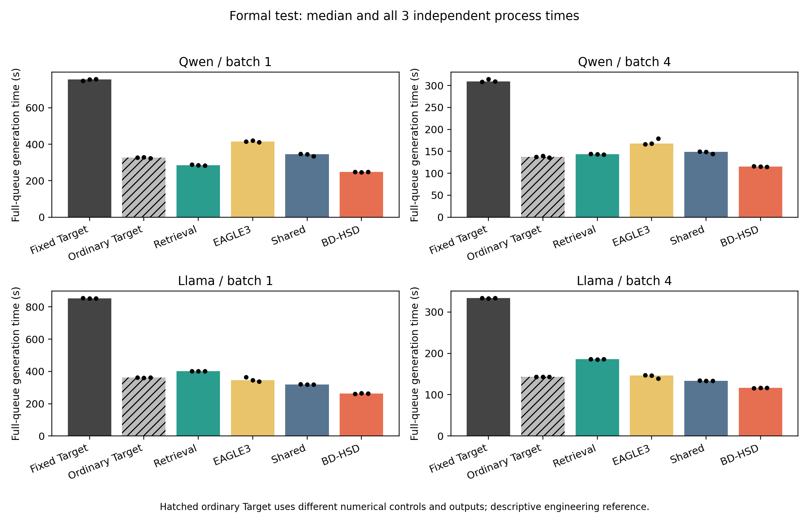
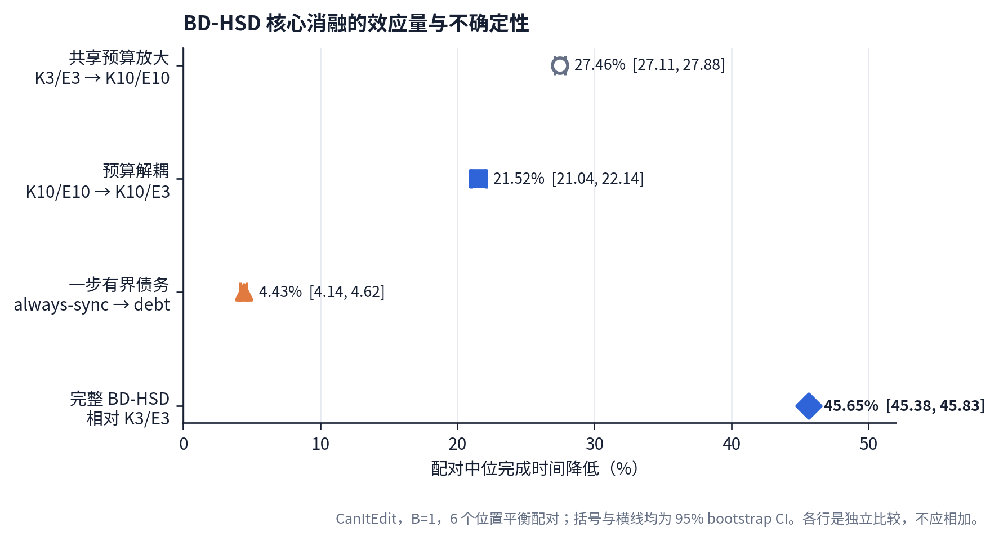
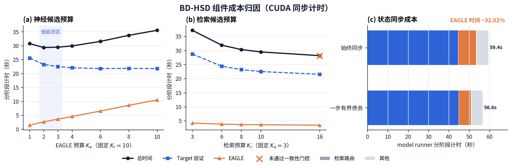
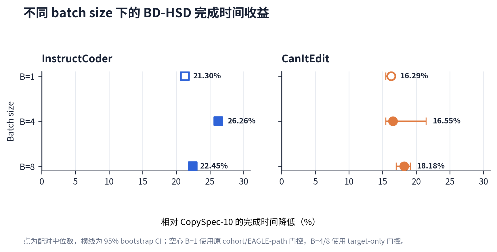

# BD-HSD 实验结果

这里保留 BD-HSD 方向可以用于项目展示和简历的结果。所有百分比都是同一引擎内的配对延迟降低，正数表示解耦或 BD-HSD 更快；原始模型权重、请求文本、GPU 日志和大体积 JSONL 不放进仓库。

机器可读版本见 [`summary.json`](summary.json)，图片见 [`figures/`](figures/)。

## 主实验：预算解耦

主实验使用单张 RTX 4090、Qwen3-8B/Llama-3.1-8B 及对应 EAGLE-3 checkpoint。每个模型使用 128 个冻结请求、3 次独立重复，比较同一引擎内经过校准的共享预算和解耦预算。所有被选中的方法格都通过逐 token 输出门控；E05 的 `verified_v2` 分析和独立复核均为 PASS。

| 模型 | Batch | 共享预算 `Kr/Ke` | 解耦预算 `Kr/Ke` | 共享 tok/s | 解耦 tok/s | 配对降低 | 95% bootstrap CI |
| --- | ---: | ---: | ---: | ---: | ---: | ---: | ---: |
| Qwen3-8B | 1 | 6/6 | 12/2 | 47.49 | 66.11 | **28.09%** | [26.06%, 30.35%] |
| Qwen3-8B | 4 | 6/6 | 12/2 | 109.93 | 142.34 | **22.71%** | [19.94%, 25.84%] |
| Llama-3.1-8B | 1 | 6/6 | 12/4 | 62.71 | 76.24 | **17.75%** | [15.84%, 19.74%] |
| Llama-3.1-8B | 4 | 6/6 | 12/4 | 149.80 | 172.22 | **13.05%** | [10.18%, 16.12%] |

主实验共记录 9,216 份重复输出、36 个独立进程和 24 个方法/模型/batch 格。表中的区间使用配对 chunk bootstrap；batch 4 的重采样单位是固定四请求块。这个结果支持“在该固定 workload 和运行配置下，检索预算与神经预算解耦有效”，不支持跨系统或任意 serving workload 的普遍速度结论。

主实验的完整方法时间对照如下。`Ordinary Target` 使用不同的数值控制和输出路径，只作为工程参考；BD-HSD 的严格速度比较使用选定 shared 与 decoupled 的共同输出门控。

## A100 独立复验

A100 结果来自单卡 NVIDIA A100-SXM4-80GB 的独立复验，使用另一个冻结的 32 请求评估子集和 3 次重复。它不和 RTX 4090 主实验合并计算区间。

| 模型 | Batch | 共享 `Kr/Ke` | 解耦 `Kr/Ke` | 3 次配对降低 | 中位降低 |
| --- | ---: | ---: | ---: | --- | ---: |
| Qwen3-8B | 1 | 8/8 | 12/2 | 14.99%, 24.20%, 30.72% | **24.20%** |
| Qwen3-8B | 4 | 8/8 | 12/2 | 22.27%, 10.96%, 23.02% | **22.27%** |
| Llama-3.1-8B | 1 | 8/8 | 12/4 | 11.57%, 0.86%, 8.40% | **8.40%** |
| Llama-3.1-8B | 4 | 8/8 | 12/2 | 19.73%, 5.70%, 9.37% | **9.37%** |

选定方法的 output mismatch count 为 0。由于这是小规模独立复验，表中报告三次配对值和中位数，不把它包装成与主实验相同的置信区间证据。

## 消融：预算解耦和状态债务

在 CanItEdit 冻结 holdout、Qwen3-8B、RTX 4090、batch 1、40 个请求上，四配置使用同一个 K10 容量引擎，6 个预先保留的配对全部通过 40/40 逐 token 正确性门控。

| 配置变化 | 延迟降低 | 95% bootstrap CI | 正向配对 |
| --- | ---: | ---: | ---: |
| K3/E3 → K10/E10，共同放大 | 27.46% | [27.11%, 27.88%] | 6/6 |
| K10/E10 → K10/E3，预算解耦 | **21.52%** | [21.04%, 22.14%] | 6/6 |
| K10/E3 同步 → K10/E3 有界债务 | **4.43%** | [4.14%, 4.62%] | 6/6 |
| K3/E3 → 完整 BD-HSD | **45.65%** | [45.38%, 45.83%] | 6/6 |

预算解耦把 EAGLE fallback 从 10 限制到 3，在同一 retrieval 容量下仍获得 21.52% 的额外降低；加入按已接受 token 记账的一步有界状态债务后，再获得约 4.4%。这两项收益来自不同机制，不能把四行百分比相加。

## 组件级成本归因

RTX 4090 上的同步阶段 trace 给出以下机制证据：

- 固定 `Kr=10` 时，EAGLE horizon 从 1 增到 10，EAGLE 时间从 1.45 s 增到 10.50 s；target verification 的收益在 E3/E4 附近趋于饱和。
- 固定 `Ke=3` 时，retrieval 从 K3 增到 K10，检索 route 总时间仅为 0.09–0.11 s，而验证轮次从 1,245 降到 974。
- 一步有界债务让 EAGLE 执行次数减少 32.63%、EAGLE 时间减少 32.02%，端到端减少 4.56%；target verification 基本不变。

## Mixed-batch 证据

在同引擎 CopySpec-10 对照中，BD-HSD 在两个代码编辑 workload 的 batch 扩展上保持正向：

| 数据集 | Batch 1 | Batch 4 | Batch 8 |
| --- | ---: | ---: | ---: |
| InstructCoder | 21.30% | **26.26%** [26.02%, 26.64%] | **22.45%** [22.14%, 22.51%] |
| CanItEdit | 16.29% | **16.55%** [15.44%, 21.45%] | **18.18%** [17.01%, 19.10%] |

Batch 4/8 使用 target-only 严格完整 batch 门控；batch 1 使用较早的配对 cohort，不用于拟合 batch 趋势。这里的结果用于展示 mixed-batch 路由和 fallback 的工程表现，主项目的预算结论以主实验和四路消融为准。

## 结果口径

- `Kr` 是 N-gram retrieval 候选预算，`Ke` 是 EAGLE 神经草稿预算。
- 所有候选都由 target model 批量验证；N-gram 和 EAGLE 不绕过 verifier。
- 选定格必须通过逐 token reference gate 才进入严格比较。
- 结果是固定模型、固定数据、固定硬件和固定 eager/greedy 配置下的实测 operating point。
- 早期开发筛选和未通过正确性门控的配置没有并入本项目结果。
